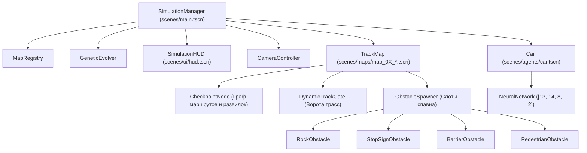

# Архитектурный план расширения Godot-NeuroCars

## 1. Анализ исходного прототипа и выявленные ограничения

Анализ текущей кодовой базы выявил пять фундаментальных узких мест, не позволяющих напрямую реализовать многоуровневость, динамические развилки, смену маршрута и сложные препятствия:

1. **Жёсткая линейная индексация чекпоинтов**: в исходном [main.gd](file:///c:/Users/user/Desktop/College%20Projects/Godot-NeuroCars/scripts/main.gd) и `car.gd` прогресс определялся формулой `(next_checkpoint + 1) % total_checkpoints`. Такая схема физически исключает развилки (шорткаты) и переключение альтернативных маршрутов после прохождения заданного числа кругов.
2. **Мгновенная кинематика без состояния ускорения**: скорость машины задавалась напрямую в каждом кадре (`velocity = transform.x * throttle * max_speed`), из-за чего невозможна механика торможения до нуля и замедленного разгона при столкновении с пешеходом.
3. **Недостаточная сенсорная и архитектурная база нейросети**: 5 лучей с шагом $30^\circ$ оставляют слепые зоны шириной >100 px на дистанции 200 px, через которые проходят узкие объекты (люди, знаки «Стоп», камни). Отсутствует вход целевого направления при появлении развилок и вход текущей скорости.
4. **Монолитные сцены без разделения ответственности**: визуалы трассы, логика эволюции, спавн и HUD дублировались в корневых сценах `main.tscn` и `track_v2.tscn` без единой точки управления картами.
5. **Фиксированный таймер поколения (60 с)**: короткий жёсткий лимит времени не давал нейроагентам завершать 3–4+ круга для срабатывания динамической смены маршрута.

---

## 2. Целевая архитектура и иерархия файлов

Проект переводится на модульную архитектуру с чётким разделением на 6 слоёв ответственности:

```text
Godot-NeuroCars/
├── project.godot
├── default_bus_layout.tres
├── icon.svg
├── docs/
│   ├── ARCHITECTURE_PLAN.md
│   └── IMPLEMENTATION_ROADMAP.md
├── resources/
│   └── themes/
│       └── hud_theme.tres
├── scenes/
│   ├── main.tscn
│   ├── agents/
│   │   └── car.tscn
│   ├── obstacles/
│   │   ├── rock_obstacle.tscn
│   │   ├── pedestrian_obstacle.tscn
│   │   ├── stop_sign_obstacle.tscn
│   │   └── barrier_obstacle.tscn
│   ├── track/
│   │   └── dynamic_gate.tscn
│   ├── ui/
│   │   └── hud.tscn
│   └── maps/
│       ├── map_01_nordschleife.tscn
│       ├── map_02_coastal_loop.tscn
│       ├── map_03_canyon_switch.tscn
│       ├── map_04_urban_grid.tscn
│       ├── map_05_alpine_pass.tscn
│       └── map_06_apex_gauntlet.tscn
└── scripts/
    ├── core/
    │   ├── simulation_config.gd
    │   ├── map_registry.gd
    │   └── simulation_manager.gd
    ├── ai/
    │   ├── neural_network.gd
    │   └── genetic_evolver.gd
    ├── agents/
    │   └── car.gd
    ├── track/
    │   ├── track_map.gd
    │   ├── checkpoint_node.gd
    │   ├── dynamic_track_gate.gd
    │   ├── obstacle_spawner.gd
    │   └── track_geometry_builder.gd
    ├── obstacles/
    │   ├── obstacle_base.gd
    │   ├── rock_obstacle.gd
    │   ├── pedestrian_obstacle.gd
    │   ├── stop_sign_obstacle.gd
    │   └── barrier_obstacle.gd
    └── ui/
        ├── hud.gd
        └── camera_controller.gd
```



---

## 3. Контракт слоёв 2D-физики (`project.godot`)

| Бит / Слой | Название | Маска | Назначение |
| :--- | :--- | :---: | :--- |
| Layer 1 | `Walls` | `1` | Стены трассы (`StaticBody2D`) и закрытые ворота `DynamicTrackGate` |
| Layer 2 | `Cars` | `2` | Агенты `Car` (`CharacterBody2D`) |
| Layer 3 | `LethalObstacles` | `4` | Летальные препятствия: камни, знаки «Стоп», ограждения (`ObstacleBase`) |
| Layer 4 | `Checkpoints` | `8` | Графовые триггеры чекпоинтов (`CheckpointNode`) |
| Layer 5 | `Pedestrians` | `16` | Пешеходы (`PedestrianObstacle` как `Area2D` с `monitorable = true`) |

- **Маска столкновений машины (`Car`)**: `1 | 4 = 5` (машины не сталкиваются друг с другом, мгновенно гибнут об стены, закрытые ворота и летальные препятствия).
- **Маска сенсоров (`RayCast2D`)**: `1 | 4 | 16 = 21` (`collide_with_bodies = true`, `collide_with_areas = true`, `hit_from_inside = true`) — лучи видят стены, закрытые ворота, летальные препятствия и пешеходов.

---

## 4. Граф маршрутов, развилок и защита ворот от замуровывания

1. **Графовые чекпоинты (`CheckpointNode`)**:
   - Каждый узел имеет `checkpoint_id: StringName`, `next_checkpoint_ids: Array[StringName]`, `route_group: StringName`, `is_shortcut: bool`, `is_lap_finish: bool`.
   - При попадании машины в допустимый узел её список `expected_checkpoint_ids` вычисляется через `TrackMap.get_open_next_ids(checkpoint_id)`, фильтруя ветви с закрытыми воротами.
   - Прохождение шортката (`is_shortcut = true`) даёт ускорение прохождения круга и дополнительный бонус `SimulationConfig.SHORTCUT_BONUS` (`+240.0`), поощряя нейросеть выбирать быстрые развилки.

2. **Динамические ворота (`DynamicTrackGate`)**:
   - Поддерживают 3 состояния: `OPEN`, `WARNING` (мигающий янтарный маячок, коллизия ещё выключена), `CLOSED` (полосатый шлагбаум и коллизия на Layer 1).
   - **Безопасное закрытие**: встроенный `SafetySensor` (`Area2D` на Layer 2) не позволяет коллизии включиться поверх машины — при наличии машин внутри створки ворота удерживаются в `WARNING` до их выезда (в пределах grace-окна 0.6 с).

3. **Смена маршрута после 3-го круга (защита от заучивания лупа)**:
   - В `TrackMap` задаётся `laps_per_route_switch = 3` и массив вариантов маршрутов `route_variant_groups` (`[&"route_a", &"route_b"]` на картах 1–4, `[&"route_a", &"route_b", &"route_c"]` на картах 5–6).
   - Когда лидер завершает 3-й круг (и далее кратно `laps_per_route_switch`), `TrackMap.advance_route_variant` открывает вход на следующий маршрут, переводит старую входную ветвь в `WARNING -> CLOSED` (выход с ветви всегда открыт), обновляет `expected_checkpoint_ids` у машин до точки расхождения, спавнит свежие препятствия в новом секторе и оповещает HUD через сигнал `route_switched`.
   - Таймер поколения в `SimulationManager` динамический: старт с `80.0` с и продление на `+28.0` с при каждом новом пройденном круге (до `260.0` с).

---

## 5. Механика препятствий и сенсорики нейросети

### 5.1. Таблица воздействий

| Препятствие | Класс / Слой | Поведение при столкновении | Штраф и эффект |
| :--- | :--- | :--- | :--- |
| **Камень** | `RockObstacle` (Layer 3) | Мгновенное выбывание (`die()`) | `-120.0` к `fitness` |
| **Знак «Стоп»** | `StopSignObstacle` (Layer 3) | Мгновенное выбывание (`die()`) | `-150.0` к `fitness` |
| **Ограждение** | `BarrierObstacle` (Layer 3) | Мгновенное выбывание (`die()`) | `-150.0` к `fitness` |
| **Пешеход** | `PedestrianObstacle` (Layer 5) | Выживает, кнут по фитнесу, сброс скорости до `0`, замедленный разгон | `-350.0` к `fitness`, `current_speed = 0.0`, восстановление ускорения за `3.5` с (множитель `0.18 -> 0.65`), кулдаун `5.0` с |

### 5.2. Гарантированная проходимость спавна (`ObstacleSpawner`)

Каждый слот на трассе хранит касательную дороги `road_tangent` и полуширину полотна `road_half_width`. При выборе случайного бокового смещения `d` соблюдается инвариант:
$$\max(W_{\text{half}} - |d| - W_{\text{obs}},\; W_{\text{half}} + |d| - W_{\text{obs}}) \ge 42.0\text{ px}$$
что математически гарантирует проезд шириной минимум 42 px при ширине машины 20 px. Кроме того, слоты спавнятся не ближе `220 px` от `SpawnPoint` и `155 px` друг от друга.

### 5.3. Архитектура `NeuralNetwork` (`[13, 14, 8, 2]`)

- **9 лучей (`RayCast2D`)**: углы $[-75^\circ, -50^\circ, -30^\circ, -15^\circ, 0^\circ, +15^\circ, +30^\circ, +50^\circ, +75^\circ]$, длина `280 px`.
- **2 входа навигации**: проекции локального вектора к следующему открытому чекпоинту `(forward_dot, right_dot)`.
- **2 входа состояния**: нормированная скорость `current_speed / max_speed` и прогресс штрафа пешехода `recovery_timer / recovery_duration`.
- **Выходы**: `steer` ($[-1, 1]$) и `throttle` ($[0.2, 1.0]$).
- **Инициализация и скрещивание**: Xavier/Glorot для `tanh` и строчный кроссовер в `GeneticEvolver` с элитизмом (4 лучших мозга), турнирной селекцией и адаптацией мутации при стагнации.

---

## 6. Прогрессия 6 карт

| # | Сцена | Название | Ширина трассы | Развилки и ворота | Смена маршрутов (после 3 кругов) | Препятствий за поколение |
| :-: | :--- | :--- | :---: | :--- | :--- | :---: |
| 1 | `map_01_nordschleife.tscn` | Nürburgring Nordschleife | 108 px | 1 шорткат с таймерными воротами | `Route A` ↔ `Route B` (GP-петля) | 4–5 |
| 2 | `map_02_coastal_loop.tscn` | Azure Coastal Sprint | 104 px | 1 внутренний шорткат с воротами | `Route A` ↔ `Route B` (Пирс-петля) | 6–7 |
| 3 | `map_03_canyon_switch.tscn` | Redrock Canyon | 98 px | Чередующиеся парные коридоры + шорткат | `Route A` ↔ `Route B` (Каньон-обход) | 8–9 |
| 4 | `map_04_urban_grid.tscn` | Metro District Circuit | 94 px | 2 уличных шортката + 2 динамических ворот | `Route A` ↔ `Route B` (Бульвар-петля) | 10–11 |
| 5 | `map_05_alpine_pass.tscn` | Alpine Switchbacks | 90 px | 2 горных шортката + 2 динамических ворот | `Route A` → `Route B` → `Route C` | 12–13 |
| 6 | `map_06_apex_gauntlet.tscn` | Apex Proving Grounds | 86 px | Парные шлюзы + 2 скоростных шортката | `Route A` → `Route B` → `Route C` | 14–15 |
